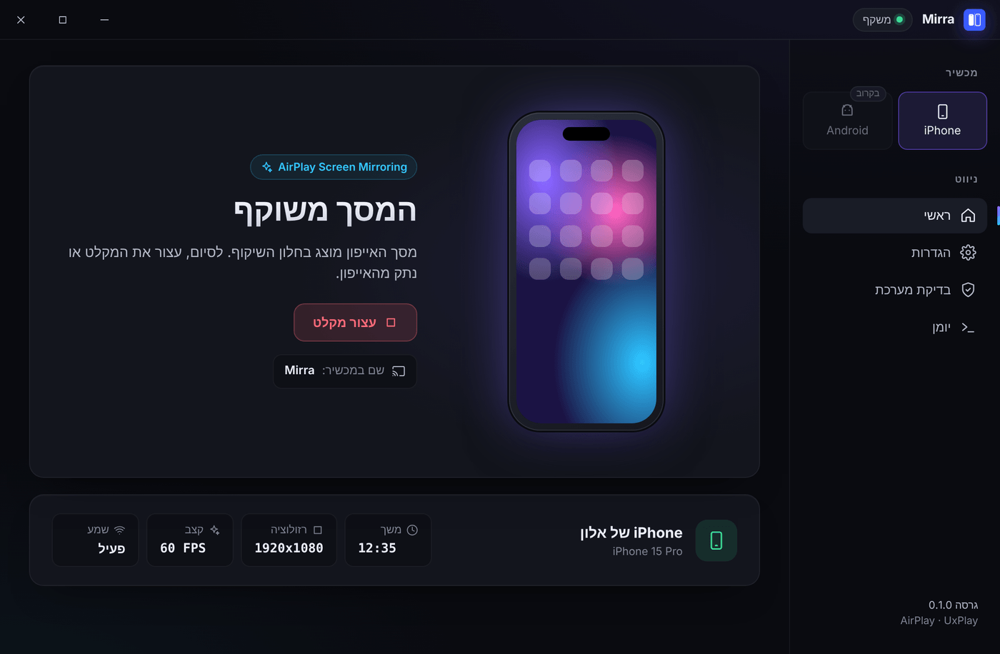
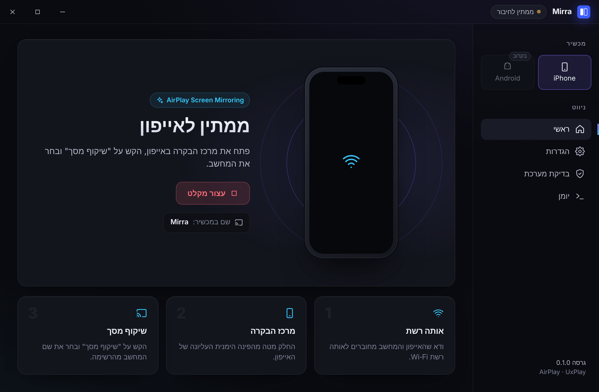
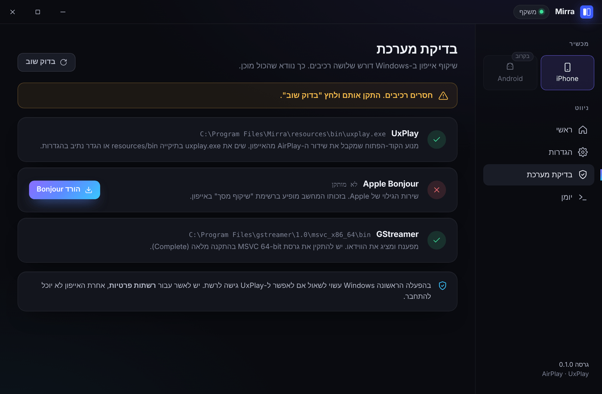
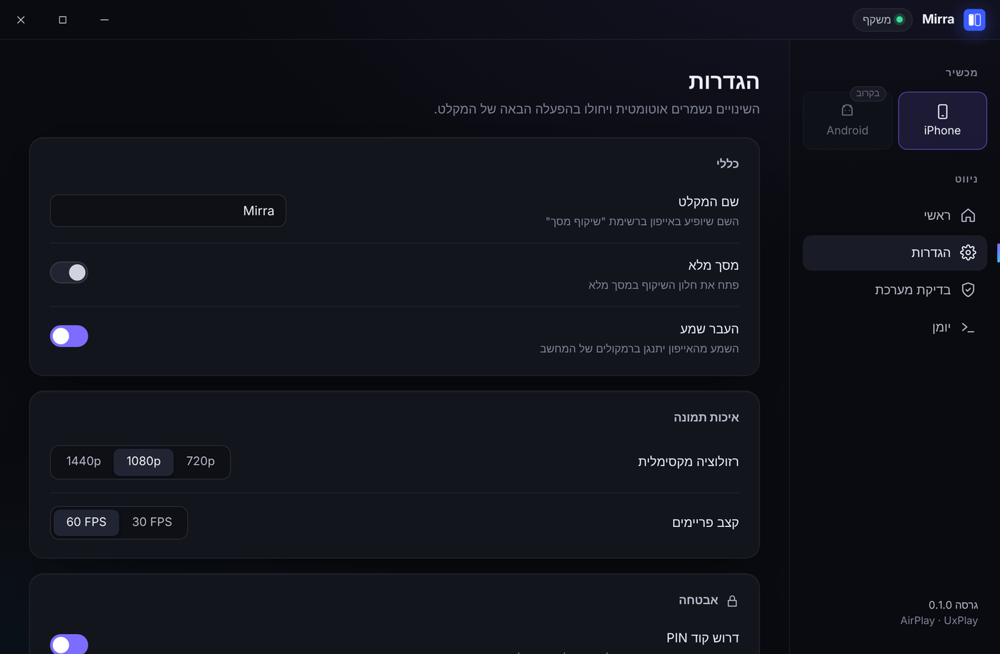

# Mirra

שיקוף מסך האייפון למחשב Windows, אלחוטית, דרך AirPlay. תמיכה באנדרואיד תגיע בהמשך.



| ממתין לחיבור | בדיקת מערכת | הגדרות |
| --- | --- | --- |
|  |  |  |

## איך זה עובד

האייפון יודע לשקף מסך רק דרך AirPlay. Mirra הופך את המחשב ל"מקלט AirPlay":

```
iPhone ──(Wi‑Fi, AirPlay)──► UxPlay (מנוע הקליטה) ──► GStreamer (מפענח ומציג וידאו)
                                   ▲
                    Mirra (Electron + React) – ממשק, הגדרות, סטטוס, יומן
```

- **UxPlay** – מנוע קוד פתוח שמממש את פרוטוקול AirPlay Mirroring. Mirra מפעיל אותו כתהליך רקע, קורא את הפלט שלו ומתרגם אותו לסטטוס (ממתין, מחובר, משקף).
- **Bonjour** – שירות של Apple שבזכותו המחשב מופיע ברשימת "שיקוף מסך" באייפון.
- **GStreamer** – מפענח את הווידאו ומציג אותו בחלון.

## דרישות (Windows 10/11)

1. **Bonjour**: התקן [Bonjour Print Services for Windows](https://support.apple.com/kb/DL999) (או iTunes, שמתקין אותו).
2. **GStreamer**: הורד את [GStreamer ל-Windows](https://gstreamer.freedesktop.org/download/#windows), גרסת **MSVC 64-bit**, והתקן בהתקנה **מלאה (Complete)**.
3. **UxPlay**: קבל `uxplay.exe` לפי [ההוראות ל-Windows](https://github.com/FDH2/UxPlay#building-uxplay-on-microsoft-windows-using-msys2-with-the-mingw-64-compiler) והעתק אותו (עם קובצי ה-DLL שלו) ל-`resources/bin/`.

מסך **בדיקת מערכת** באפליקציה בודק את שלושתם ומציג קישורי הורדה למה שחסר.

בהפעלה הראשונה Windows ישאל אם לאפשר ל-UxPlay גישה לרשת: אשר עבור **רשתות פרטיות**.

## הרצה בפיתוח

```bash
npm install
npm run dev        # פותח את האפליקציה עם hot reload
npm test           # בדיקות לפענוח הפלט של UxPlay ולבניית הפקודה
npm run typecheck
npm run dist       # בונה מתקין Windows לתיקייה release/
```

אין עדיין UxPlay? לחץ **מצב דמו** במסך הראשי: האפליקציה תדמה אייפון שמתחבר, כדי שאפשר יהיה לעבוד על הממשק.

## מבנה הפרויקט

```
src/
  main/               תהליך ה-Electron הראשי
    index.ts          חלון, IPC
    receiver.ts       ניהול תהליך UxPlay, מצבים, מצב דמו
    uxplayParser.ts   תרגום שורות פלט של UxPlay לאירועים (המקום לעדכן אם UxPlay משנה הודעות)
    uxplayArgs.ts     בניית שורת הפקודה מההגדרות
    deps.ts           איתור uxplay.exe ובדיקת Bonjour / GStreamer
    settings.ts       שמירת הגדרות ב-JSON
  preload/            גשר מאובטח (contextBridge) בין הממשק לתהליך הראשי
  shared/types.ts     טיפוסים משותפים
  renderer/           ממשק React (עברית, RTL, דארק מוד)
tests/                בדיקות יחידה
```

## מגבלות ידועות בגרסה 0.1

- הווידאו מוצג בחלון נפרד של UxPlay/GStreamer, לא בתוך חלון האפליקציה. הטמעה בתוך החלון היא השלב הבא.
- זיהוי המצבים מבוסס על טקסט הפלט של UxPlay; גרסאות שונות של UxPlay עשויות לנסח הודעות אחרת (ראה `uxplayParser.ts`).

## מפת דרכים

- [ ] הצגת הווידאו בתוך חלון האפליקציה
- [ ] צילום מסך והקלטה
- [ ] **אנדרואיד** דרך [scrcpy](https://github.com/Genymobile/scrcpy) (USB / Wi‑Fi, כולל שליטה בעכבר ומקלדת). הממשק כבר בנוי סביב "מקלט" כללי (`ReceiverStatus.platform`), כך שאנדרואיד יתווסף כמקלט נוסף.
- [ ] מתקין שכולל את UxPlay ו-GStreamer

## רישיון

UxPlay מופץ תחת GPL-3.0, ולכן גם Mirra מופץ תחת **GPL-3.0-or-later**.
